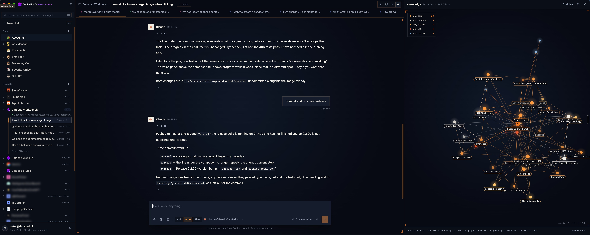

# Datapad Workbench

Unofficial desktop for [Grok Build](https://grok.com/build) and [Claude Code](https://claude.com/claude-code). Projects in a sidebar, multiple chats at once, and bots that work in their own folders and on schedules.
Thought process window, Browser window, Git Window. Talk to your agent with local voice.

Not affiliated with, endorsed by, or sponsored by SpaceXAI / xAI or Anthropic. “Grok” and “Grok Build” are their marks, as are “Claude” and “Claude Code”.



## Run

Installers are on [GitHub Releases](https://github.com/Datapad-nl/DatapadWorkbench/releases): a `.dmg` for Apple silicon Macs, an `.exe` for Windows (x64) and an `.AppImage` for Linux (x64). Installed builds check for a new release on start, download it in the background and install it when you quit. The Windows installer is not signed, so SmartScreen asks before it runs. You still need an agent installed and signed in (step 3 below).

To run from source, `npm run dev` opens a development window:

1. Clone this repository.
2. Install [Node.js 22](https://nodejs.org/).
3. Install at least one agent and sign in:
   - the [Grok Build CLI](https://x.ai/news/grok-build-cli): `grok login` (SuperGrok)
   - [Claude Code](https://claude.com/claude-code): `claude auth login` (Claude Pro or Max)
4. `npm install`
5. `npm run dev`

Optional: copy `.env.example` to `.env` and set `XAI_API_KEY` if you want an API key instead of `grok login`.

In development, `WORKBENCH_USER_DATA` points the app at another data folder, so a test copy can run next to the installed app.

Electron 44 does not download its binary during `npm install`. `npm install` and `npm run dev` run `node_modules/electron/install.js` first, which writes `path.txt` and downloads the binary for this platform. That step exits immediately when the binary is already present. On macOS the same script then registers a signed Electron shell at `~/Applications/Datapad Workbench.app` (and tries `/Applications`) so the microphone permission prompt uses this app’s name. That is not a standalone Workbench build — start the app with `npm run dev`. If an installed release is already in `/Applications`, the script leaves it alone.

If `npm run dev` still fails with `Electron uninstall`, the binary is missing. Download it, then start again.

Windows (PowerShell):

```powershell
node node_modules\electron\install.js
npm run dev
```

macOS / Linux:

```sh
node node_modules/electron/install.js
npm run dev
```

Chats are real Grok Build or Claude Code sessions. Sessions already on disk for a folder (`~/.grok/sessions`, `~/.claude/projects`) show up in that project.

`npm run typecheck` is the compile gate, `npm run lint` runs ESLint, and `npm test` runs the unit tests. CI runs all three. `npm run build` emits the Electron bundle to `out/`. `npm run dist` builds installers for the current platform into `dist/`.

### Release

1. Set `version` in `package.json` and commit.
2. Push a matching tag, like `git tag v0.2.0 && git push origin v0.2.0`.
3. The Release workflow builds on macOS, Windows and Linux and uploads everything to one draft release. Publish the draft; installed apps pick it up from then on.

Each platform is built on its own runner because the bundled Claude Code binary is platform-specific. The Mac build is signed and notarized when these repository secrets are set:

| Secret | Value |
| --- | --- |
| `MAC_CERT_P12_BASE64` | The Developer ID Application certificate and key, exported as `.p12`, then base64 |
| `MAC_CERT_PASSWORD` | The `.p12` password |
| `APPLE_ID` | The Apple ID that notarizes |
| `APPLE_APP_SPECIFIC_PASSWORD` | An app-specific password for that Apple ID |
| `APPLE_TEAM_ID` | The team id, like `3FZVG3KWR3` |

Without them the Mac build is unsigned, and macOS will not install its updates.

## Index your code

Workbench uses the [Codegraph](https://github.com/colbymchenry/codegraph) CLI to index a project folder (file count, symbols, orientation card). Install it once on your machine.

macOS / Linux:

```sh
curl -fsSL https://raw.githubusercontent.com/colbymchenry/codegraph/main/install.sh | sh
```

Windows (PowerShell):

```powershell
irm https://raw.githubusercontent.com/colbymchenry/codegraph/main/install.ps1 | iex
```

Or, if you already have Node: `npm i -g @colbymchenry/codegraph`

Open a new terminal after install so `codegraph` is on your PATH, then restart Workbench. If the binary is not on PATH, set `CODEGRAPH_BIN` in `.env` to its full path.

You do not need `codegraph install` — that wires other agents. Attach a folder to a project; Workbench runs `codegraph init` itself. If the CLI is missing, it will try the install script, then the npm package.

## What works now

**Desktop**

- Native window; size and pane layout persist
- Projects in a sidebar, each with an optional local folder, color, and rename
- Blur a project's name and icon in the sidebar for a screen recording
- Closing the window closes it. Only a small part keeps running in the menu bar: the scheduler, the pull request watcher and agents in the middle of a turn. The window comes back when you open it again. The menu bar icon lists the bots with their next run and the chats waiting for an answer, plus Open at Login

**Voice**

- Talk to your agent on this machine. Listening uses a local Whisper model; replies use [Supertonic 3](https://huggingface.co/supertone-oss-archive/supertonic-3), a local neural voice downloaded on first use. Audio never leaves the computer
- Conversation mode: a live loop — listen, send as you talk, speak replies, interrupt
- Speak replies, send when you stop talking, and keep listening after replies
- Mic, voice, speed, and language in Settings. Language is the one replies are spoken in, or Auto to pick one per reply. Turn on Voice, then use the Conversation button in the chat

**Chats**

- Multiple chats per project, each on Grok or Claude
- Each chat has its own model and effort (menu next to Ask · Auto · Plan, or `/model` and `/effort`). A started chat can switch between Claude and Grok and keeps the conversation
- Concurrent streams: switch tabs without cancelling
- Real Grok Build and Claude Code sessions — sessions already on disk for a folder show up in that project
- Search the sidebar by project name, chat title, or anything said in a chat
- A notification and Dock badge when a chat finishes or needs your approval while Workbench is in the background
- Ask / Auto / Plan permission modes, including plan cards you can approve, revise, or abandon
- Isolated git worktrees so concurrent chats on the same repo do not clobber each other: a chat gets one when another chat is already working in the folder, or when you ask for an experiment
- Chats that share a folder ask before editing a file another chat changed and has not committed: wait for that chat, edit anyway, or skip
- Checkpoints and rewind of files plus later messages
- Replies show the time they were posted, and the date too (with the year when it is not this year) for a message from an earlier day; hover for the full date
- Click an image in a chat to see it larger in an overlay
- Questions the agent asks during a turn show in the chat, and your answer goes back to it
- A Claude chat shows its subagents and background commands above the composer, and the reply the agent writes when that work ends
- Handoff: when the context passes 60% or 120k tokens, the chat offers to continue in a new chat that starts from a written summary (`/handoff`)
- First-run project briefing, Codegraph index status, and an orientation card

**Panes**

- Thought process: live tool and activity stream
- Browser: in-app webview with tabs; each project and bot keeps its own set, saved across restarts. The agent can drive the selected tab of its own project; pick and annotate a page element; screenshots; YouTube captions; a Developer Tools button; Forget cookies and logins
- Git: branch, ahead/behind, commit graph, diffs, stage / unstage / discard, commit, checkout, new branch, merge a chat’s worktree branch back into the project
- Knowledge: Obsidian-compatible `knowledge/` vault with a graph pane and generated maps

**Composer**

- Markdown replies, `@file` / folder mentions, pasted screenshots, and attachments of any file type (up to 25 MB; the agent gets a non-image file as a path to read)
- Slash-command palette: `/new`, `/rewind`, `/plan`, `/ask`, `/always-approve`, `/commit`, `/review`, `/model`, `/settings`, `/usage`, `/transcribe`, `/btw`, `/export` (save the chat as Markdown), and more
- The agent’s own commands and skills show in the same palette, such as `/compact` and `/context`. Grok chats also get `/imagine`
- MCP servers for every chat: Settings → MCP (or `/mcps`) takes the usual `mcpServers` JSON, local commands or `http`/`sse` URLs. Search the MCP Registry from there. They load next to the Workbench’s own `browser` and `workbench` servers and each agent’s own MCP config
- Steer a running task, or `/btw` a side question without dropping it. In a Claude chat a steer goes into the running turn, so its subagents keep going

**Agent tools**

Every chat gets the Workbench's `workbench` MCP server next to `browser`:

- `show_visual`: a chart, diagram or mock-up drawn as HTML, shown sandboxed in the chat
- `delegate` and `nudge`: hand a task to a child chat on Grok or Claude, optionally in its own worktree, wait for its answer, and send it back with a follow-up. Settings caps how many run at once
- `/conduct <job>`: the chat plans, hands each task to a subagent with acceptance criteria, and checks what comes back. A Claude chat with subagents allowed orchestrates them the same way
- `list_chats`, `read_chat` and `start_chat`: look up and open other chats in the same project. A bot, from its own chat, can name a project (`list_projects` shows them) to give that project a job in a new chat and read its answer later
- `schedule_task` and `cancel_schedule`: run a prompt in the project once or on a cron. Each schedule has its own chat in the sidebar with the time to its next run
- `link_pr`, `pr_status` and `unlink_pr`: link a GitHub pull request to the chat, show its checks and review state, and wake the chat when checks finish, a review comes in or it closes. Uses the GitHub CLI (`gh`)
- `request_secret`: the agent asks for an API key or token; you type it in a password field, it is kept encrypted with the system keychain per project, or per bot for a bot's own secrets, and set as an environment variable in the agent's shell. The model never sees the value

**Bots**

- A Bots section in the sidebar. A bot is an agent of its own with a name, an avatar, instructions, a model, the tools it may use without asking, skills and schedules, and it works in its own folder
- Each bot has its own chat, and its schedules are listed under it in the sidebar. A finished scheduled run posts its answer in the bot's chat
- Type `@` in a chat to ask a bot. A message that starts with `@Name` goes to that bot; a bot named later in a message is asked by the chat's agent with `ask_bot`. A bot asked from a chat answers at once with "On it." and a Working sign, and its answer then takes that message's place. Its permission prompts, questions and secret requests show in the asking chat
- Each bot keeps a memory folder with a `MEMORY.md` index, and all bots share a memory for what every bot should know
- Documents: add PDF, EPUB, text and Markdown files, converted into one Markdown file per chapter with an outline
- Skills from [skills.sh](https://skills.sh), and a pick of MCP servers per bot
- A Grok bot makes images with the image model (`image_gen`, `image_edit`)
- Chief of staff: a bot the app makes, which cannot be deleted. On a heartbeat (every 30 minutes from 08:00 to 18:59 by default) it reads its checklist and the open work each bot keeps in `STATUS.md`, hands due work to the right bot with `ask_bot`, and notifies you only when something needs you. Each bot keeps a `LESSONS.md` in its memory that its sessions start with, and adds a rule there when something goes wrong. What a bot cannot solve itself, and every failed or interrupted run, goes in its `PROBLEMS.md`; the chief reviews those on the heartbeat, writes the lesson in that bot's `LESSONS.md` and removes the entry

**Settings**

- One dialog with sections: Agent, Subagents, Voice, Memory, Secrets, MCP servers, Appearance and About
- Default agent for new chats: Grok or Claude
- Short replies: chats you talk to (Grok and Claude) answer briefly. Each bot has its own switch on its page
- Grok signs in with `grok login` (SuperGrok), with an optional API-key fallback. Claude uses your `claude auth login`
- Model and effort picker: Grok 4.6 by default; Claude chats list the models and effort levels Claude Code offers
- Subagents: the model for a conductor, the model for every worker, and how many run at once (or None)
- Secrets: the names kept per project or per bot, with delete
- Appearance: built-in themes plus import and export of custom themes, and a chat width (Standard, Wide, Wider or Full)
- Usage snapshot in the status bar

## License

[MIT](LICENSE)

## Contributing

See [CONTRIBUTING.md](CONTRIBUTING.md). To report a vulnerability, see [SECURITY.md](SECURITY.md).
